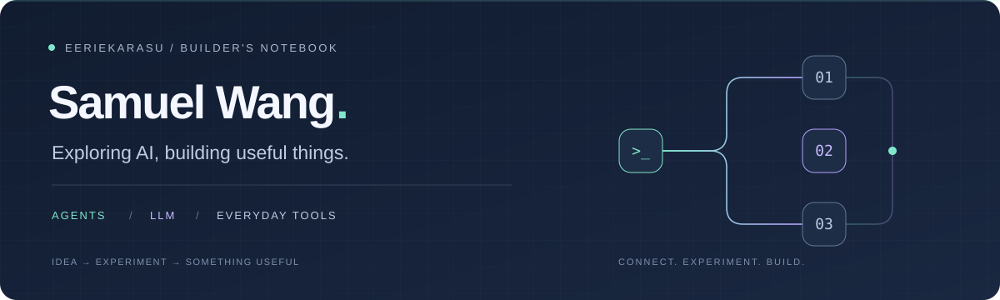

  

  <b>你好，我是 Samuel / eErieKarasu。</b> 
  探索 AI Agent 与大模型应用，也把生活里的小需求做成能用的工具。

  <a href="https://github.com/eErieKarasu?tab=repositories">浏览项目</a> &nbsp; · &nbsp;
  <a href="https://github.com/eErieKarasu?tab=stars">学习与收藏</a>

---

### 01 / 我在探索

**Agent 工作流** — 将研究、分析、可视化和写作串成自动化流程。 
**LLM 实践** — 从 API 应用到基于开源项目的本地训练与部署。 
**实用工具** — 文档分析、家庭菜谱，以及日常需求的小型应用。

### 02 / 项目选集

<table>
  <tr>
    <td width="50%" valign="top">
      <h3><a href="https://github.com/eErieKarasu/ReportTeam">ReportTeam ↗</a></h3>
      
<b>从一个问题到一份研究报告。</b>

      
个人学习项目，探索规划、在线研究、数据分析、图表与写作的 Agent 协作流程。

      
Python · asyncio · Gemini · Playwright

    </td>
    <td width="50%" valign="top">
      <h3><a href="https://github.com/eErieKarasu/LoveMenu">LoveMenu ↗</a></h3>
      
<b>把「今天吃什么」变成可执行的菜单。</b>

      
微信小程序，连接家庭菜谱、今日点菜、采购清单与食材库存，支持 AI 辅助创建菜品。

      
JavaScript · 微信小程序 · 云开发

    </td>
  </tr>
  <tr>
    <td width="50%" valign="top">
      <h3><a href="https://github.com/eErieKarasu/PDFChecker">PDFChecker ↗</a></h3>
      
<b>让文档里的异常更容易被发现。</b>

      
结合元数据、内部结构与内容特征，辅助识别 PDF 中可能存在的修改痕迹。

      
Python · PyMuPDF · pikepdf

    </td>
    <td width="50%" valign="top">
      <h3><a href="https://github.com/eErieKarasu/atom">atom ↗</a></h3>
      
<b>从本地训练理解大模型。</b>

      
基于 MiniMind 的本地 LLM 训练与部署实践，记录从应用模型到理解模型的探索。

      
Python · LLM · MiniMind

    </td>
  </tr>
</table>

### 03 / 实践中用到

  
  
  
  
  

 

保持好奇，把想法做成可以运行的东西。 Stay curious. Make it work.

